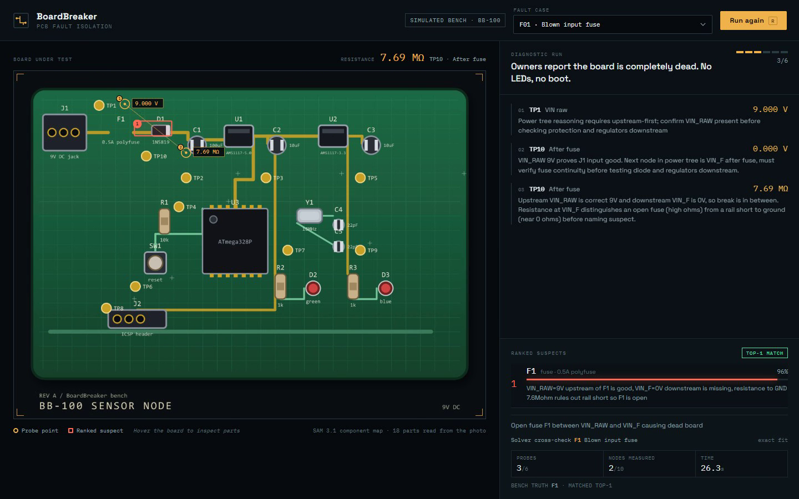

# BoardBreaker

**PCB fault isolation from a board photo and a handful of probe readings.**

BoardBreaker is a diagnostic agent for dead circuit boards. It looks at a photo of
the board, works out which component is which, then asks for a small number of
multimeter measurements and ranks the parts most likely to be at fault.

Built for the Meta Global AI Developer Hackathon, Indie track.

---

## The problem

When a board comes in dead, someone has to trace the power tree by hand: input,
protection, regulator, rails, loads. It is slow, it needs experience, and the
first ten minutes are usually spent measuring the same five nodes every time.

BoardBreaker does the tracing. It reads the board, plans the measurements, and
stops as soon as the evidence points at a part.

## What it does

1. **Read the board.** A photo goes to **SAM 3.1**, which segments the
   components. A vision model reads the silkscreen next to each segment and
   returns a component map (`F1 fuse · 0.5A polyfuse`, `U1 regulator ·
   AMS1117-5.0`, and so on).
2. **Plan the probes.** The symptom, the component map and the netlist go to
   **Muse Spark**. It walks the power tree and chooses one measurement at a
   time, with a hard budget of six probes.
3. **Update on evidence.** Each reading goes back into the conversation. The
   agent explains why it chose the probe and what the result rules out.
4. **Rank and cross-check.** It returns ranked suspects with a reason for each.
   A DC solver then re-simulates every known fault mode at the *same probed
   nodes* and reports which hypothesis fits the readings best.

## Demo



Live: **https://boardbreaker-ten.vercel.app**

The board is the interface: probe points light up as they are measured, and the
ranked suspects are boxed on the photo.

A recorded run is in [`docs/boardbreaker-demo.mp4`](docs/boardbreaker-demo.mp4)
(1m35s, silent, 1440x900). It plays fault F01 end to end: the reported symptom, the probes the agent chooses, the ranked suspects and the solver cross-check.

## Results

Benchmark: 18 single-fault cases on the BB-100 board, six-probe budget.

| System | Top-1 | Top-3 |
| --- | --- | --- |
| Deterministic full sweep (15 probes) | 17/18 | 18/18 |
| Muse Spark agent (6 probes, model ranking) | 16/18 | 17/18 |
| Agent probes + solver cross-check | 18/18 | 18/18 |

The full-sweep baseline is the ceiling: with every node measured, the solver can
separate almost every fault. The agent has to reach the same answer with six
measurements it chose itself. The interesting number is not the ceiling, it is
how much of it survives the probe budget.

The closest pair is `F02` vs `F03` (open diode vs diode installed backwards).
Both block forward current, both point at D1, and only the photo can tell them
apart in the field. On this bench the solver's resistance reading separates
them; that is a property of the model, not a claim about real boards.

## The simulated bench

There is no physical hardware in this build. `BB-100` is a synthetic sensor node
defined in `src/bench/board.ts`: 18 components, 10 test points, a 9V input, a
reverse-polarity diode, 5V and 3.3V LDO rails, an ATmega328P, a reset network,
two status LEDs, a crystal and an ISP header. Its DC behaviour is solved with
modified nodal analysis (`src/bench/solver.ts`), including diode and regulator
iteration.

The bench is how the agent is evaluated without a lab. Every reading the model
sees is produced by the solver from a board with a planted fault, so the
benchmark is reproducible and the ground truth is exact.

The product path is the same pipeline with real measurements. The bench and the
hardware differ only in where a reading comes from; that boundary is
`measureVoltage` / `measureResistance` in `src/bench/readings.ts`.

## Run it

Requirements: Node 20+ and a Meta Model API key with access to SAM 3.1 and
Muse Spark.

```bash
npm install
# .env.local
# MODEL_API_KEY=your-key

npm run build:web
npm start            # http://localhost:8787
```

Development, two terminals:

```bash
npm run dev          # API on :8787
npm run dev:web      # Vite on :5173, proxies /api
```

Other commands:

```bash
npm test             # solver and bench tests (9 tests)
npm run check        # runtime check against a running server on :8787
npm run eval         # deterministic full-sweep baseline
npm run agent        # agent over all 18 faults
npx tsx src/eval/agent-run.ts F01 F06   # selected cases
```

## How it is built

```
src/
  bench/     BB-100 definition, DC solver, fault injection, readings, renderer
  vision/    Meta API client, SAM 3.1 segmentation, silkscreen -> component map
  agent/     probe-budget diagnostic loop, structured output, solver cross-check
  eval/      baseline, agent benchmark, key check
server/      Express API, SSE stream of probes and final diagnosis
web/         React interface (Vite), board overlay, probe log, ranked suspects
```

- **Models:** SAM 3.1 for segmentation, Muse Spark 1.3 for vision and reasoning,
  both through the Meta Model API using structured JSON output.
- **Solver:** modified nodal analysis with Newton-style iteration for diodes and
  regulators, 10M bleed resistors so isolated nets read like a real meter.
- **Ohmmeter model:** a 1V source through 1k, with a compliance check, so a
  floating net reads `OL` instead of producing an impossible voltage.

## Limits

- DC only. No signals, no AC, no firmware.
- One fault at a time.
- The component map depends on silkscreen that is readable in the photo.
- The netlist comes from the board profile. On an unknown board it would have to
  be inferred or entered by the user; the vision map is the first step toward
  that.
- The bench is simulated, and the benchmark is small. The numbers are a
  sanity check, not a field study.

## Real-board ingestion

The BB-100 profile is synthetic, so the ingestion path was checked against a real
open-hardware design: the Olimex ESP32-DevKit-LiPo Rev C KiCad netlist, vendored
under oardsolimex-esp32-devkit-lipo\ with its Apache-2.0 licence.
src
etlistkicad.ts parses it to 54 parts and 72 nets, including the
ESP32-WROOM-32D, the BL4054B LiPo charger and both 19-pin headers
(ode --import tsx scripts
etlist-report.ts boardsolimex-esp32-devkit-lipo
ev-c.net).
That proves the format is ingestible; it is not a validated diagnosis of that
board, and the evaluation numbers in docs
esults.md are all BB-100.

## Next

- A hardware adapter: bench supply, DMM and a switch matrix, so the same agent
  drives real probes.
- Netlist inference from the photo plus continuity tests, removing the board
  profile requirement.
- Multi-fault hypotheses and thermal evidence.
